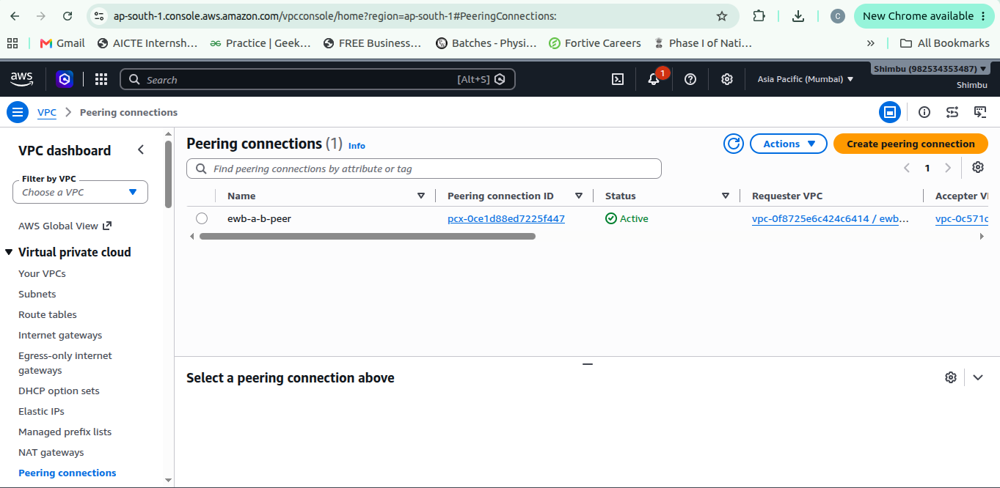

# AWS VPC Peering Project — Private Communication Between Two VPCs

> **Project status:** Lab configuration completed / connectivity troubleshooting documented  
> **Cloud provider:** Amazon Web Services (AWS)  
> **Region:** Asia Pacific (Mumbai) — `ap-south-1`  
> **Purpose:** Demonstrate VPC design, VPC peering, route tables, security groups, bastion-host access, and connectivity validation.

## Table of Contents

- [Project Overview](#project-overview)
- [Architecture](#architecture)
- [Network Plan](#network-plan)
- [AWS Resources](#aws-resources)
- [Implementation Steps](#implementation-steps)
- [Security Group Rules](#security-group-rules)
- [Connectivity Validation](#connectivity-validation)
- [Screenshots and Evidence](#screenshots-and-evidence)
- [Cleanup and Cost Control](#cleanup-and-cost-control)
- [Lessons Learned](#lessons-learned)
- [Repository Structure](#repository-structure)

## Project Overview

This lab demonstrates how to connect two separate Amazon Virtual Private Clouds (VPCs) using **VPC Peering**. VPC A hosts a bastion instance and a private application instance (App-A). VPC B hosts a private application instance (App-B). A peering connection provides a private network path between the two VPC CIDR ranges when the connection, route tables, and security groups are configured correctly.

The lab also demonstrates the role of a bastion host as an administrative entry point to private instances and the importance of restricting SSH and ICMP access to known sources.

**Important evidence note:** During this lab, SSH access to the private instances timed out during troubleshooting, and successful App-A ↔ App-B ping connectivity was not confirmed. Any terminal output labelled **Expected / Simulated Output** in this README is illustrative only and is not proof that the command succeeded in the AWS environment. Replace the placeholders with genuine screenshots and actual command output if you rerun the tests successfully.

## Architecture

```text
                         Administrator laptop
                                  |
                             SSH (TCP/22)
                                  |
                     +--------------------------+
                     | Bastion Host             |
                     | VPC A public subnet      |
                     | Private IP: 10.10.1.118  |
                     | Public IP: see AWS       |
                     +--------------------------+
                                  |
                +-----------------+-----------------+
                |                                   |
       +---------------------+             VPC Peering Connection
       | VPC A               |          10.10.0.0/16 <-> 10.20.0.0/16
       | 10.10.0.0/16        |                       |
       |                     |                       |
       | App-A               |                       |
       | 10.10.2.10          |                       |
       | Private subnet      |                       |
       +---------------------+                       |
                                                     |
                                         +------------------------+
                                         | VPC B                  |
                                         | 10.20.0.0/16           |
                                         |                        |
                                         | App-B                  |
                                         | 10.20.1.10             |
                                         | Private subnet         |
                                         +------------------------+
```

> The IP addresses above are the intended lab addresses. Confirm the actual private IPs in the EC2 console before using them in commands or presenting them as observed values.

## Network Plan

| Component | Name | CIDR / Address | Purpose |
|---|---|---|---|
| VPC A | `ewb-vpc-a` | `10.10.0.0/16` | Bastion and App-A |
| VPC A public subnet | `ewb-a-public` | `10.10.1.0/24` | Bastion host |
| VPC A private subnet | `ewb-a-private` | `10.10.2.0/24` | App-A |
| Bastion | `ewb-bastion` | Intended private IP `10.10.1.10`; actual instance used during troubleshooting showed `10.10.1.118` | SSH entry point |
| App-A | `ewb-app-a` | Intended `10.10.2.10` | Private workload in VPC A |
| VPC B | `ewb-vpc-b` | `10.20.0.0/16` | App-B |
| VPC B private subnet | `ewb-b-private` | `10.20.1.0/24` | App-B |
| App-B | `ewb-app-b` | Intended `10.20.1.10` | Private workload in VPC B |
| Peering connection | `ewb-a-b-peer` | AWS-generated `pcx-...` ID | Private routing between VPCs |

**IP note:** The project design originally expected the bastion at `10.10.1.10`, but the launched bastion instance shown during troubleshooting had private IP `10.10.1.118`. Security group rules allowing SSH from the bastion must use the **actual bastion private IP** (or a suitably scoped bastion security group reference, where supported and appropriate), not a stale planned IP.

## AWS Resources

- Two VPCs with non-overlapping CIDR blocks.
- Public subnet and internet gateway route in VPC A for the bastion.
- Private subnets for App-A and App-B.
- One EC2 bastion host and two private EC2 instances.
- One VPC peering connection.
- Route tables with routes to the peer VPC CIDR.
- Security groups for bastion, App-A, and App-B.
- A key pair used for SSH authentication.

AMI and usernames can vary. In this lab, the instances were launched with an Ubuntu image, so the default username was `ubuntu`. For Amazon Linux, the usual default username is `ec2-user`.

## Implementation Steps

### 1. Create VPC A

1. Open the AWS VPC console in `ap-south-1`.
2. Create `ewb-vpc-a` with CIDR `10.10.0.0/16`.
3. Create public subnet `ewb-a-public` with CIDR `10.10.1.0/24`.
4. Create private subnet `ewb-a-private` with CIDR `10.10.2.0/24`.
5. Create and attach an internet gateway to VPC A.
6. Associate the public subnet with a route table that includes:
   - VPC local route.
   - `0.0.0.0/0` to the internet gateway.

### 2. Create VPC B

1. Create `ewb-vpc-b` with CIDR `10.20.0.0/16`.
2. Create private subnet `ewb-b-private` with CIDR `10.20.1.0/24`.
3. Keep the subnet private; do not assign App-B a public IPv4 address for this design.

### 3. Create the EC2 instances

Launch the instances in the correct VPC and subnet:

- `ewb-bastion` in `ewb-a-public`.
- `ewb-app-a` in `ewb-a-private`.
- `ewb-app-b` in `ewb-b-private`.

Use a consistent key pair and record each instance's actual private IP. The intended App-A and App-B addresses are `10.10.2.10` and `10.20.1.10`, respectively. If using fixed private IPs, ensure the addresses are available in their subnets.

### 4. Create the VPC peering connection

1. Open **VPC → Peering connections**.
2. Create a peering request from `ewb-vpc-a` to `ewb-vpc-b`.
3. Accept the request if required.
4. Confirm that the connection status is **Active**.

### 5. Configure route tables

Add the peering routes to the route tables associated with the relevant subnets.

| Route table | Destination | Target |
|---|---|---|
| VPC A private route table | `10.20.0.0/16` | VPC peering connection |
| VPC B private route table | `10.10.0.0/16` | VPC peering connection |
| VPC A public route table (for bastion-to-App-B access) | `10.20.0.0/16` | VPC peering connection |

Keep the automatic local route in each VPC. The public route table should also retain its internet gateway default route if the bastion needs internet access. Verify the correct route table is associated with each subnet.

### 6. Configure security groups

Use least-privilege inbound rules. Do not open SSH to `0.0.0.0/0`.

#### Bastion security group — `ewb-sg-bastion`

| Type | Protocol / Port | Source |
|---|---|---|
| SSH | TCP 22 | Administrator's current public IP `/32` |

#### App-A security group — `ewb-sg-app-a`

| Type | Protocol / Port | Source |
|---|---|---|
| SSH | TCP 22 | Bastion's actual private IP `/32` or an appropriate restricted bastion security group reference |
| ICMP Echo Request | ICMP | `10.20.1.10/32` |

#### App-B security group — `ewb-sg-app-b`

| Type | Protocol / Port | Source |
|---|---|---|
| SSH | TCP 22 | Bastion's actual private IP `/32` or an appropriate restricted bastion security group reference |
| ICMP Echo Request | ICMP | `10.10.2.10/32` |

Security groups are stateful. Ensure outbound rules also permit the required traffic. Network ACLs, operating-system firewall rules, and route-table associations can also affect connectivity.

### 7. Connect to the bastion

From a Linux laptop, restrict permissions on the private key and connect with the correct AMI username:

```bash
chmod 400 ~/Downloads/Webserver.pem
ssh -i ~/Downloads/Webserver.pem ubuntu@BASTION_PUBLIC_IP
```

Replace `BASTION_PUBLIC_IP` with the current public IPv4 address from the EC2 console. Never publish or commit the `.pem` private key to GitHub.

### 8. Connect to App-A or App-B

A safer approach is to use SSH ProxyJump from the laptop, so the private key stays on the laptop:

```bash
ssh -i ~/Downloads/Webserver.pem \
  -o IdentitiesOnly=yes \
  -J ubuntu@BASTION_PUBLIC_IP \
  ubuntu@10.10.2.10
```

For App-B:

```bash
ssh -i ~/Downloads/Webserver.pem \
  -o IdentitiesOnly=yes \
  -J ubuntu@BASTION_PUBLIC_IP \
  ubuntu@10.20.1.10
```

These commands require working bastion authentication, valid private IPs, the correct key pair and usernames, SSH access permitted by security groups, and working network routes. If SSH times out, verify the instance state, IP, security groups, route-table associations, peering status, network ACLs, and OS firewall.

**Security note:** Avoid copying a private key onto the bastion. If a key was temporarily copied for a lab, remove that copy after use and ensure it is not included in logs or source control.

## Connectivity Validation

### Test 1 — Verify the host and private IP

On each connected instance:

```bash
hostname
ip -4 addr
```

Confirm that the hostname and private address match the intended instance.

### Test 2 — App-A to App-B

Run on App-A:

```bash
ping -c 4 10.20.1.10
```

**Successful output:**

```text
PING 10.20.1.10 (10.20.1.10) 56(84) bytes of data.
64 bytes from 10.20.1.10: icmp_seq=1 ttl=64 time=1.21 ms
64 bytes from 10.20.1.10: icmp_seq=2 ttl=64 time=0.94 ms
64 bytes from 10.20.1.10: icmp_seq=3 ttl=64 time=1.05 ms
64 bytes from 10.20.1.10: icmp_seq=4 ttl=64 time=0.88 ms

--- 10.20.1.10 ping statistics ---
4 packets transmitted, 4 received, 0% packet loss
```

### Test 3 — App-B to App-A

Run on App-B:

```bash
ping -c 4 10.10.2.10
```

**Successful result:** four replies and `0% packet loss`.

### Actual lab result

During the lab, the bastion host was reachable at `10.10.1.118`, but SSH attempts to the private App-A and App-B instances timed out during troubleshooting. Successful bidirectional App-A ↔ App-B ping was **not verified**. Therefore, this README does not claim that the connectivity tests passed.

If rerunning the lab, capture actual command output and update this section with the verified result.

## Screenshots and Evidence

Replace the placeholders below with your own genuine AWS console screenshots. Do not present simulated terminal output as actual AWS evidence.

| Screenshot | Suggested file | What it should show |
|---|---|---|
| VPC overview | `01-vpc-overview.png` | Both VPC names and CIDR blocks |
| Peering connection | `02-vpc-peering.png` | Peering ID and actual connection status |
| VPC A private routes | `03-vpc-a-private-routes.png` | Route to `10.20.0.0/16` via peering |
| VPC B private routes | `04-vpc-b-private-routes.png` | Route to `10.10.0.0/16` via peering |
| VPC A public routes | `05-vpc-a-public-routes.png` | Internet gateway route and peering route if configured |
| Subnets | `06-subnets.png` | Subnet names, CIDRs, and VPC associations |
| Security groups | `07-security-groups.png` | Restricted SSH and ICMP rules |
| EC2 instances | `08-ec2-instances.png` | Instance names, private IPs, and observed states |
| App-A ping test | `09-app-a-to-app-b.png` | Actual App-A terminal test result, if completed |
| App-B ping test | `10-app-b-to-app-a.png` | Actual App-B terminal test result, if completed |

Example Markdown for adding a screenshot:

```markdown

```

## Cleanup and Cost Control

After collecting the evidence:

1. Terminate the project EC2 instances: `ewb-app-a`, `ewb-app-b`, and `ewb-bastion`.
2. Wait for termination and check for EBS volumes that remain in `Available` state. Delete only project volumes that are no longer needed.
3. Review and remove unnecessary project snapshots.
4. Check for NAT Gateways, paid VPC endpoints, and allocated Elastic IP addresses. Remove project resources you no longer need.
5. Delete the VPC peering connection.
6. Detach and delete the project internet gateway.
7. Delete project subnets, non-default route tables, and project security groups as dependencies allow.
8. Delete `ewb-vpc-a` and `ewb-vpc-b`.
9. Recheck EC2, EBS, VPC networking resources, and Billing/Cost Explorer. Billing data can take time to update.

Only delete resources created for this lab; do not delete unrelated AWS resources. Do not delete the key pair if you still use it elsewhere. Terminating instances does not automatically remove every billable resource.

## Lessons Learned

- VPC peering requires non-overlapping VPC CIDR ranges.
- A peering connection alone is not enough: the correct route tables and security group rules must also be configured.
- A private EC2 instance without a public IP is not directly accessible through public EC2 Instance Connect; use a bastion, a configured EC2 Instance Connect Endpoint, or Systems Manager where properly set up.
- SSH timeouts often indicate routing, security group, network ACL, or host-firewall issues; `Permission denied (publickey)` points to authentication, username, or key mismatch.
- Always confirm the instance's actual private IP and the bastion's actual private IP before writing security group rules.
- Capture real evidence before deleting resources, and clean up unused AWS resources promptly to control costs.
- Never commit private keys, credentials, account IDs, or other secrets to a public repository.

## Repository Structure

Recommended structure:

```text
aws-vpc-peering-project/
├── README.md
└──
    ├── 01-vpc-overview.png
    ├── 02-vpc-peering.png
    ├── 03-vpc-a-private-routes.png
    ├── 04-vpc-b-private-routes.png
    ├── 05-vpc-a-public-routes.png
    ├── 06-subnets.png
    ├── 07-security-groups.png
    ├── 08-ec2-instances.png
    ├── 09-app-a-to-app-b.png
    └── 10-app-b-to-app-a.png
```

---

**Author:** Chittiboina Siva Narasimhulu
**Project:** AWS VPC Peering — Private Communication Between Two VPCs  
**Region:** `ap-south-1` (Mumbai)

